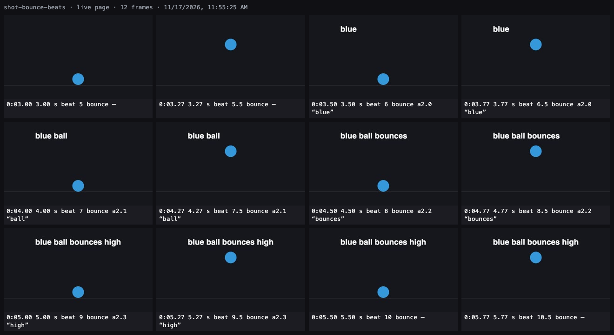

# beatclip

A command-line tool for editing code-rendered music videos from timestamped notes ("at 1:07 the ball should land on the beat").

It is for videos where a web page draws every frame as a pure function of the song time and a script screenshots that page frame by frame. beatclip answers the questions that come up on every round of changes:

- What is on screen at 1:07, which shot, lyric word and beat is that? (`at`, `find`, `beat`)
- What does it look like now, and what did it look like in the last draft? (`frames`)
- Can I re-render just this shot? (`render` with a frame cache)
- Which notes are done, and where is the proof? (`notes`)
- What actually changed between two drafts, and did anything change that nobody asked for? (`diff`)
- Is every lyric word still on screen when it is sung? (`check`, `probe`)



## Install

Needs [Bun](https://bun.sh), Google Chrome, and `ffmpeg` and `ffprobe` on the PATH. Developed on macOS; it should run on Linux, and it is not written for Windows (it uses `sh` and `ps`).

```bash
curl -fsSL https://raw.githubusercontent.com/jozso39/beatclip/main/install.sh | sh
```

This clones the repository to `~/.beatclip`, puts `beatclip` on your PATH and links the [Claude Code skill](#claude-code-skill) into `~/.claude/skills`. Run it again to update. From a clone of your own, `sh install.sh` installs that clone instead.

Then, in your video project:

```bash
beatclip doctor
```

`doctor` checks the machine (Bun, ffmpeg, Chrome) and the project (config, audio, lyrics, beat grid, the page and its hooks) and says how to fix what is missing. `beatclip init` writes a starter config, and `beatclip docs` prints this manual.

Run `beatclip` from the project folder (it looks for `beatclip.config.json` there and in the parent folders), or pass `--project <folder>`, or set `BEATCLIP_PROJECT`.

## Claude Code skill

[skills/beatclip/SKILL.md](skills/beatclip/SKILL.md) teaches Claude Code to use the tool: installing it, setting up a project, every command, and the routine for a round of timestamped notes (record the note, find its shot, keep a before frame, change, compare, render, prove, diff, check, report). The installer links it into `~/.claude/skills/beatclip`, so it is available in every session and is updated together with the tool.

## Try the demo

`demo/` is a twelve-second video of three coloured shapes on a 120 BPM beat with made-up lyrics. Its page server is started for you when a command needs the page.

```bash
bun demo/make-audio.ts
```

```bash
cd demo && beatclip at 0:04.2
```

All examples below are real output from the demo.

## What the page must expose

| Hook | Meaning |
| --- | --- |
| `window.__seek(t)` | Draw the frame of time `t` (seconds). May return a promise. The picture must depend on `t` only, not on what was drawn before. |
| `window.__duration` | Length of the video in seconds. |
| `window.__ready` | Set to `true` once fonts, images and the hooks above are in place. |
| `window.__shots` (optional) | `[{ id, s }]`: every shot with its start time. A shot ends where the next one starts. |

The names can be changed in the config. [demo/index.html](demo/index.html) is a minimal page with all four.

For `check`, each lyric word needs an element that a CSS selector can find from the line id and the word index (the demo uses `class="lw" data-word="a2:1"`). For `probe`, mark an element with `data-probe="<name>"`.

## The config file

`beatclip.config.json` in the project root. Every path is relative to it. The demo's config:

```json
{
  "page": {
    "url": "http://localhost:5210/index.html?render=1",
    "width": 640,
    "height": 360,
    "shots": "__shots",
    "start": "bun serve.ts 5210"
  },
  "fps": 30,
  "audio": "audio/click.wav",
  "lyrics": "lyrics.json",
  "sources": ["scene.js", "index.html", "lyrics.json"],
  "cues": [
    { "name": "ball first lands", "t": 3.5 },
    { "name": "bar full", "t": 8.5 }
  ],
  "beats": { "first": 0.5, "interval": 0.5, "perBar": 4 },
  "out": { "dir": "out", "video": "out/demo-{n}.mp4" },
  "render": { "workers": 4 },
  "check": {
    "selector": ".lw[data-word=\"{line}:{word}\"]",
    "allow": "beatclip.allow.json",
    "probes": [
      { "probe": "ball", "assert": "lowest-on-beat", "from": 3, "to": 6 },
      { "probe": "ball", "assert": "no-overlap", "with": "words", "from": 3, "to": 6 }
    ]
  }
}
```

| Key | Meaning |
| --- | --- |
| `page.url`, `page.width`, `page.height` | The page to drive and its frame size. |
| `page.ready`, `page.seek`, `page.duration` | Hook names; default `__ready`, `__seek`, `__duration`. |
| `page.shots` | Name of the shot-list hook. Or leave it out and list the shots yourself: `"shots": [{ "id": "intro", "s": 0 }]`. |
| `page.start` | Command that starts the page's server when the URL does not answer (optional). It must stay in the foreground (not `... &` or a daemonising command). It is stopped when the last beatclip command using it ends; a server you started yourself is never stopped. |
| `page.channel` | Browser channel for playwright-core, default `chrome`. |
| `fps` | Frames per second of the video, default 60. |
| `duration` | Length in seconds. Optional: otherwise read from the page hook (and cached with the shot list). |
| `audio` | The song: muxed into renders, and the default input of `analyze beats`. |
| `lyrics` | JSON with `lines: [{ id, text, s, e, words: [{ w, s, e }] }]`. Optional `shouts: [{ id, s, e, letters: [{ c, s, e }] }]` (chanted letters) are read as lines of one-letter words. |
| `sources` | Globs of the files the picture depends on. Used three ways: the shot list read from the page is cached until one of them changes, a render waits until they have been quiet for `render.settleMs`, and a render starts over when one changes while it is shooting. Shot ids are also searched in these files to report where a shot is defined. |
| `cues` | Named moments: `[{ "name": "bar full", "t": 8.5 }]`. |
| `beats` | `{ "first": 0.5, "interval": 0.5 }` for a constant tempo, or `{ "file": "beats.json" }` for measured beat times. `perBar` adds bar numbers. |
| `out` | `dir` (default `out`), and inside it by default: `sheets` (`sheets`), `cache` (`cache/frames`), `proofs` (`proofs`), `video` (`video-{n}.mp4`; `{n}` becomes the first free number). |
| `notes` | The ledger file, default `beatclip.notes.json`. |
| `differs` | From which difference two frames count as different, default 10 (see [How frames are compared](#how-frames-are-compared)). |
| `render` | `workers` (8), `quality` (JPEG, 93), `scale` (device scale factor, 1), `crf` (17), `preset` (`medium`), `settleMs` (1500), `samples` (frames re-shot to check the cache, 40), `differs` (difference from which a re-shot frame no longer matches the cache, 8). |
| `check` | `selector` of a word's element with `{line}` and `{word}` placeholders, `before` (0.15 s), `after` (0.02 s), `visible` (0.85), `hidden` (0.5), `frame` (`left`, `top`, `right`, `bottom` of the area words must stay inside), `shouts` (also check chanted letters, false), `allow` (the allowlist file), `probes` (rules, see `check`). |
| `python` | Python with librosa, only for `analyze beats`. |

## Times, words and beats

Everywhere a time is expected you can write `1:07`, `1:07.5` or `67.5`. A lyric word is named `<line id>.<index from 0>`, for example `a2.1`. Beats are numbered from 0; `7.5` is the half beat after beat 7.

Every command prints a readable answer by default and JSON with `--json`. Errors go to stderr with exit code 1 (and `{"error": ...}` on stdout with `--json`); an unexpected crash exits with 2. An option a command does not have, a leftover argument, or a one-value option given twice is an error, so a typo cannot silently turn into a different run. Progress of long commands goes to stderr.

## Commands

### `beatclip at <time>`

What is on at a time: shot (with the file and line where its id is written, when found in `sources`), lyric line and word, nearest cue, beat.

```
$ beatclip at 0:04.2
0:04.20 (4.20 s)  frame 126
shot   bounce  0:03.00–0:06.00  (1.20 s in)  scene.js:8
line   a2  "blue ball bounces high"  0:03.50–0:05.50
word   a2.1  "ball"  0:04.00–0:04.50  (being sung)
cue    "ball first lands" at 0:03.50 (+0.70 s from it)
beat   7 + 0.40  bar 2, beat 4  (nearest: beat 7 at 0:04.00, +0.20 s from it)
```

### `beatclip find <text>`

The reverse: times of lyric words (or runs of words), lines, cues and shots matching a text.

```
$ beatclip find ball
 0:03.50     3.50 s  cue   ball first lands
 0:04.00     4.00 s  word  a2.1         ball  (to 0:04.50)
```

### `beatclip beat <time> [--next|--prev] [--half] [+N|-N]`

The time of a beat: the nearest one by default, the next or previous one, on the half-beat grid with `--half`, moved by `+N`/`-N` beats. `beatclip beat --n 8` gives the time of beat 8.

```
$ beatclip beat 4.2 --next --half
beat 7.5 at 0:04.25 (4.25 s)  frame 128  (+0.05 s from 0:04.20)
shot   bounce  0:03.00–0:06.00  (1.25 s in)  scene.js:8
line   a2  "blue ball bounces high"  0:03.50–0:05.50
word   a2.1  "ball"  0:04.00–0:04.50  (being sung)
cue    "ball first lands" at 0:03.50 (+0.75 s from it)
```

### `beatclip analyze beats [audio]`

For songs without a constant tempo: tracks the beats with librosa and writes a beat-times file to use as `"beats": { "file": ... }`. It also prints the constant grid that fits best and how far the worst beat is from it, so you can tell whether a constant grid is good enough. This is the only command that needs Python: `--python <path>` or `"python"` in the config, with librosa installed. Without an audio argument it analyses the config's `audio` and writes the config's beats file if one is set; for any other audio it writes `<name>.beats.json` in the project root. `--out <file>` chooses the file.

```
$ beatclip analyze beats --python ~/venv/bin/python --out out/click.beats.json
23 beats, 117.5 BPM, first at 0:00.51, last at 0:11.52
constant grid that fits best: first 0.522 s, interval 0.5 s; the worst beat is 11 ms off it
wrote out/click.beats.json
use it with  "beats": { "file": "<path to it>" }  in the config
```

### `beatclip frames`

Labelled contact sheets from the live page or from a rendered file. Each tile carries its time, shot and the lyric word being sung.

```bash
beatclip frames 0:04 0:04.25 0:04.5            # explicit times
beatclip frames --from 3 --to 6 --every 0.5    # a range
beatclip frames --shot bounce                  # a shot: 12 frames spread over it (--count, --every)
beatclip frames --word a2.1 --window 0.3       # around the start of a lyric word
beatclip frames --shot bounce --beats --half   # on every beat or half beat
beatclip frames --shot bounce --video out/demo-2.mp4                         # from a rendered file
beatclip frames --shot bounce --compare out/demo-1.mp4                       # live page beside a draft
beatclip frames --shot bounce --video out/demo-2.mp4 --compare out/demo-1.mp4   # two drafts
```

```
$ beatclip frames --shot bounce --beats --video out/demo-2.mp4 --compare out/demo-1.mp4
out/sheets/20261117-115333-shot-bounce-beats-demo-2-vs-demo-1.png
6 frames from demo-2.mp4 beside demo-1.mp4: 0:03.00 to 0:05.50; 6 of 6 differ (diff >= 10)
```

Times are snapped to video frames. With `--compare` the two pictures of a time stand side by side and each label ends with their difference, marked `≠` when it reaches `differs`. Options: `--cols`, `--rows` (per sheet, default 6; more tiles make more sheets), `--width` (tile width, default 480), `--out <file.png>`.

Sheets are written to `out/sheets/<timestamp>-<what>.png`, a new name every time. If any capture fails the command exits with an error and writes nothing, and an existing file is never overwritten:

```
$ beatclip frames 4 --video out/missing.mp4
beatclip: no such video: /path/to/project/out/missing.mp4
```

### `beatclip render`

Screenshots the page frame by frame into a persistent frame cache (`out/cache/frames`, one JPEG per frame) and encodes the video from the cache with ffmpeg.

```bash
beatclip render                         # full render
beatclip render --from 1:05 --to 1:09   # re-shoot a range, encode the whole video from the cache
beatclip render --shot bounce           # the range of a shot (repeatable, as is --from/--to)
beatclip render --note 1                # the range of a note from the ledger
beatclip render --notes                 # the ranges of all open and done notes
beatclip render --shot bounce --excerpt # encode only that stretch: a quick look
```

```
$ beatclip render
out/demo-1.mp4
full render: 360 frames
screenshots  2.2 s  (360 frames, 163.6 frames/s, 4 workers)
check        0.0 s  (not needed for a full render)
encode       0.2 s  (360 frames from the cache)
total        2.8 s
```

A partial render re-shoots only the asked ranges. To make sure nothing else changed, it then re-shoots a sample of frames outside them (the frames next to each range edge, the middle of every shot, and a spread over the rest) and compares them with the cache. If some no longer match, it says which times, widens the ranges by the whole shots those frames are in, and checks again; if that keeps failing or would cover most of the video, it shoots everything. Here the ball was recoloured, the note covered only the `bounce` shot, and the check found the ball in `finale` too:

```
$ beatclip render --note 1
check: 11 of 40 frames outside 0:03.00–0:06.00 no longer match the cache: 0:09.17 (finale, diff 95.0), 0:09.47 (finale, diff 95.0), ...
check: widening to 0:03.00–0:06.00, 0:09.00–0:12.00
out/demo-2.mp4
partial render: 0:03.00–0:06.00, 0:09.00–0:12.00, 180 of 360 frames shot
screenshots  2.3 s  (180 frames, 78.3 frames/s, 4 workers)
check        5.1 s  (11 frames outside the asked ranges differed from the cache; widened to 0:03.00–0:06.00, 0:09.00–0:12.00)
encode       0.2 s  (360 frames from the cache)
total        8.1 s
```

```
$ beatclip render --shot bounce --excerpt
out/excerpt-3.00-6.00-1.mp4
partial render: 0:03.00–0:06.00, 90 of 360 frames shot
screenshots  0.9 s  (90 frames, 100.0 frames/s, 4 workers)
check        0.7 s  (40 frames outside the range re-shot, all match the cache)
encode       0.1 s  (only the excerpt, 90 frames from the cache)
total        2.2 s
```

Things it takes care of:

- **A dev server that is reloading.** Before shooting it waits until no file in `sources` has changed for `render.settleMs`. If the page reloads while it is shooting, it waits and shoots those frames again instead of dying. If a source file is added, removed or modified in any way at any point of the render (while shooting, checking or widening), every range shot so far is shot again, so the cache never keeps frames of two versions of the code. This guard works from the files listed in `sources`: list everything the picture depends on.
- **Two renders at once.** A lock in the cache folder lets only one render write a project's cache; the second one stops with an error. Other commands (`frames`, `check`, `notes`) can run alongside a render and share a page server started through `page.start`; it is stopped by whichever command finishes last.
- **A cache that cannot be used.** With no cache yet, an incomplete one, or one shot with another size, frame rate, quality or URL, a partial render becomes a full one and says why.
- **An interrupted partial render.** The ranges being re-shot are recorded and shot again with the next render.
- **A page that is not quite a pure function of time.** A browser may paint the same time slightly differently after different earlier frames. A sampled frame that mismatches the cache is therefore re-shot arriving from other frames; if one of those reproduces the cached picture it is reported as unstable and nothing is widened.
- **Output.** `{n}` in the video name is the first free number. A name without `{n}` that already exists is refused before anything is shot, so a draft is never overwritten. The file appears only when ffmpeg succeeded.
- **A video that got shorter.** A full render removes cached frames past the new end.

Other options: `--full`, `--out <file>` (not with `--excerpt` or `--no-encode`), `--no-encode` (update the cache only), `--no-verify` (skip the check), `--no-widen` (fail instead of widening). The time each part took is always printed.

### `beatclip notes`

A ledger (`beatclip.notes.json`) tying each change note to its time, its status and its proof frames.

```bash
beatclip notes add 0:04 "the ball should be orange"         # --to <time> makes it a range
beatclip notes list                                         # --status open|done|verified|rejected
beatclip notes proof 1 before --video out/demo-1.mp4        # a frame at the note's time; without --video from the live page; --at <time>
beatclip notes proof 1 after --video out/demo-2.mp4
beatclip notes set 1 done --shows "an orange ball on the floor line under the word ball"   # also --text, --to <time>, --to none
beatclip notes remove 2
beatclip notes report                                       # --out report.md
```

```
$ beatclip notes add 0:04 "the ball should be orange"
note #1 at 0:04.00: shot bounce, word a2.1 "ball"

$ beatclip notes proof 1 after --video out/demo-2.mp4
out/proofs/note-1-after-20261117-115331.jpg
note #1 after proof at 0:04.00 from out/demo-2.mp4
before and after: diff 95.0

$ beatclip notes report
2 notes: 0 open, 2 done, 0 verified, 0 rejected

| # | Change | Time in the video | Shot | Status | What the frame shows | Proof |
| --- | --- | --- | --- | --- | --- | --- |
| 1 | the ball should be orange | 0:04.00 | bounce | done | an orange ball on the floor line under the word ball | [before](out/proofs/note-1-before-20261117-115320.jpg) · [after](out/proofs/note-1-after-20261117-115331.jpg) (diff 95.0) |
| 2 | the bar should grow faster | 0:07.00–0:08.50 | grow | done |  |  |
```

When the before and after proofs of a note look the same, `proof` says so and the report marks the row `LOOKS UNCHANGED`: the change was made in the code but does not read in the frame.

A note without `--to` stands for the whole shot around its time when it drives `render --note` / `render --notes`.

### `beatclip diff <a.mp4> <b.mp4>`

Time ranges where two drafts differ. With notes in the ledger it also says which ranges no note accounts for (something changed that nobody asked for) and which notes marked done show no difference where they point (something was reported as changed but is not).

```
$ beatclip diff out/demo-1.mp4 out/demo-2.mp4
2 ranges differ between demo-1.mp4 and demo-2.mp4  (360 frames compared; a frame differs when diff >= 10 of 255)
  0:03.00–0:06.00       3.00 s   peak diff  96.0 at 0:03.23   bounce       notes #1
  0:09.00–0:12.00       3.00 s   peak diff  96.0 at 0:09.00   finale       NO NOTE
1 of 2 ranges have no note
note #2 (done) at 0:07.00 "the bar should grow faster": NO DIFFERENCE between the two drafts in its range
look at one:  beatclip frames --from 3 --to 6 --video out/demo-1.mp4 --compare out/demo-2.mp4
```

A note accounts for a range anywhere in its shot (or its own range). Options: `--threshold` (default `differs`), `--gap` (seconds across which differing frames are joined into one range, default 0.5).

### `beatclip check`

Checks every lyric word against the page: hidden `before` seconds ahead of its first sound, visible at it, and inside the frame. Problems listed in the allowlist are known exceptions, and the exit code is 1 only for new ones, so a clean result reads "0 new problems". `--update-allow` accepts the current problems as the allowlist, `--all` also prints the known ones.

```
$ beatclip check --all
known  0:08.00  a3.3     "wide"           already visible 0.15 s before its first sound
16 words and 2 probe rules checked: 0 new problems, 1 known exceptions
```

The allowlist is a file of `{ "allow": [{ "key": "a3.3", "kind": "early", "why": "..." }] }`. For a word the key is its name and the kinds are `missing` (no element), `late` (not visible at its first sound), `outside` (outside the frame) and `early`. For a probe rule the key names the probe, the rule and the exact failure, for example `probe:ball lowest-on-beat 3.70` (kind `off-beat`) or `probe:ball no-overlap word a2.1` (kind `overlap`), so a failure that moves counts as new. An entry that is no longer a problem is reported as fixed.

Probe rules in `check.probes` assert things about elements marked `data-probe`, between `from` and `to`:

| `assert` | Holds when |
| --- | --- |
| `lowest-on-beat` | every turning point where the element is lowest on screen falls on a beat (`"half": true` for half beats, `"tolerance"` in seconds, default 0.05) |
| `highest-on-beat` | the same for its highest points |
| `no-overlap` | its box never intersects `"with"`: another probe's name, or `"words"` for every lyric word |

### `beatclip probe <name> [times..]`

The box of a `data-probe` element (or of any `--selector <css>`) at given times, or with `--from/--to` and `--lowest` / `--highest` its turning points and how far each is from a beat.

```
$ beatclip probe ball 3.5 3.75
0:03.50  x 295–345  y 250–300  shown 1.00
0:03.75  x 295–345  y 100–150  shown 1.00

$ beatclip probe ball --from 3 --to 6 --lowest
0:03.50  lowest point y 300  +0.00 s from beat 6 (0:03.50)
0:04.00  lowest point y 300  +0.00 s from beat 7 (0:04.00)
0:04.50  lowest point y 300  +0.00 s from beat 8 (0:04.50)
0:05.00  lowest point y 300  +0.00 s from beat 9 (0:05.00)
0:05.50  lowest point y 300  +0.00 s from beat 10 (0:05.50)
```

## How frames are compared

Everywhere two pictures are compared (`frames --compare`, note proofs, `diff`, the cache check of `render`) the number is the same: both pictures are scaled to 480 pixels wide and subtracted, the result is averaged over 8×8 blocks, and the largest block average is the difference, from 0 (identical) to 255. Unlike a whole-frame score such as SSIM it stays high when only one small element changed, and it stays low for compression noise. As a guide: two encodes of the same frames stay below about 4, a live page against its encoded frame below about 8, and a real change of an element is usually above 20. `differs` (default 10) is the line between "same" and "different".

## A round of changes

```bash
beatclip notes add 1:07 "the ball should land on the beat"   # one per note, in the user's words
beatclip at 1:07                                             # where is that: shot, source file, word, beat
beatclip notes proof 1 before --video out/draft-3.mp4        # the frame before the change
# ... edit the scene ...
beatclip frames --shot bounce --compare out/draft-3.mp4      # does the change read? live page beside the last draft
beatclip render --notes                                      # re-shoot only what the notes cover
beatclip notes proof 1 after --video out/draft-4.mp4
beatclip notes set 1 done --shows "the ball touches the floor line on beat 134"
beatclip diff out/draft-3.mp4 out/draft-4.mp4                # anything changed that no note covers?
beatclip check                                               # 0 new problems
beatclip notes report                                        # the table to hand back
```

## Tests

```bash
bun test
```

`test/core.test.ts` covers the time, beat and range logic. `test/cli.test.ts` runs the real command line against a copy of the demo project (real Chrome, real ffmpeg): sheets, full and partial renders, a stale cache being caught, a source edited during and after a shoot, two commands at once, the ledger, `diff` and `check`.

## License

MIT
